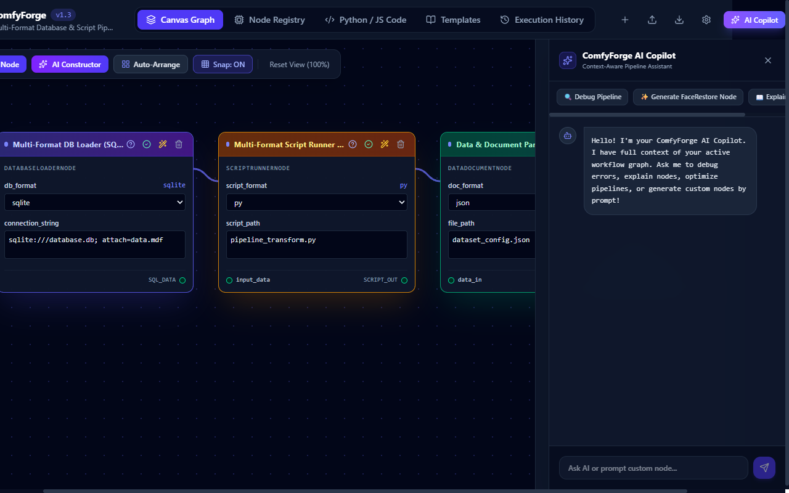
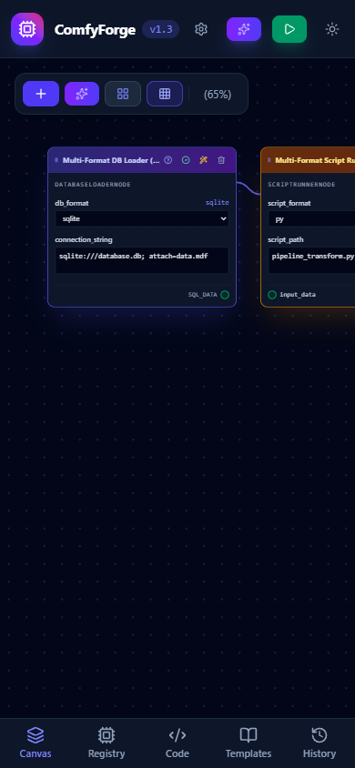
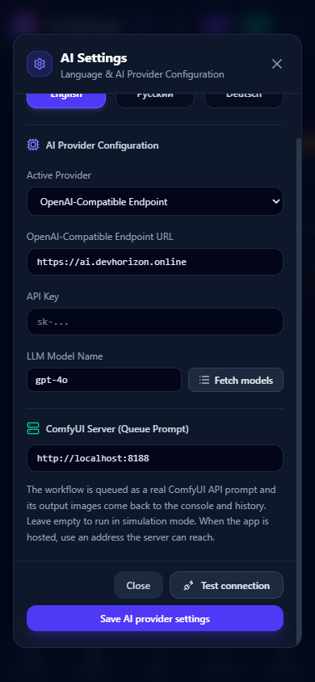
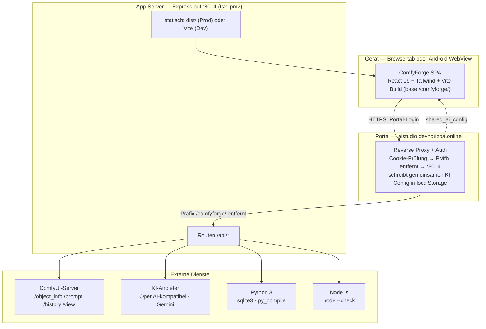

# ComfyForge AI IDE

[English](README.md) · [Русский](README.ru.md) · **Deutsch**

Ein visuelles Knoten-IDE im ComfyUI-Stil für den Browser (und als Android-App):
Knotengraph, den man von Hand baut und verdrahtet, echter Import/Export von
ComfyUI-Workflow-JSON, Ausführung auf einem echten ComfyUI-Server, eine
SQLite-Konsole und ein KI-Copilot mit Blick auf den gesamten Workflow.



| | |
|---|---|
| **Live-App** | https://aistudio.devhorizon.online/comfyforge/ (hinter Portal-Login) |
| **Quellcode** | https://github.com/sashok53011/comfyforge-ai-ide |
| **Android-APK** | [Einstellungen → Android APK](https://aistudio.devhorizon.online/comfyforge/) oder `public/ComfyForge-AI-IDE.apk` in diesem Repo |
| **Stack** | React 19 · Vite 8 · Tailwind 4 · Express · TypeScript · Capacitor 8 |

---

## Inhalt

1. [Funktionen](#funktionen)
2. [Screenshots](#screenshots)
3. [Architektur](#architektur)
4. [Verzeichnisstruktur](#verzeichnisstruktur)
5. [Server-API](#server-api)
6. [Frontend-Datenfluss](#frontend-datenfluss)
7. [Abläufe](#abläufe)
8. [Zustand & Persistenz](#zustand--persistenz)
9. [Portal-Integration](#portal-integration)
10. [Android-App](#android-app)
11. [Sicherheitsentscheidungen](#sicherheitsentscheidungen)
12. [Starten, Bauen, Deployen](#starten-bauen-deployen)
13. [Bekannte Einschränkungen](#bekannte-einschränkungen)
14. [TODO](#todo)
15. [Kommandos](#kommandos)

---

## Funktionen

**Graph-Editor**
- Knoten hinzufügen / ziehen / löschen, Auto-Anordnung, Rasterfang, Zoom &
  Schwenken.
- **Verbindungen**: Ausgangsport antippen, dann Eingangsport — Typprüfung,
  ein Eingang = eine Verbindung, `Esc` oder ein Klick auf leere Leinwand bricht
  ab.
- **Touch-Eingabe**: Pointer-Events + Pinch-Zoom, untere Tab-Leiste am Handy,
  Vollbild-Inspektor-Sheet, `touch-action: none` auf der Leinwand.

**ComfyUI-Kompatibilität**
- Export im echten ComfyUI-*Save*-Format (Datei auf eine ComfyUI-Leinwand
  legen) und Import von *Save*, *API (prompt)* und eigenen Exporten (verlustfrei
  — der interne Schnappschuss reist in `extra.comfyforge`).
- **Ausführung**: der Workflow wird in das API-Prompt-Format umgewandelt,
  Knotenklassen gegen `/object_info` geprüft, an `/prompt` gesendet, über
  `/history/{id}` abgefragt; Ausgabebilder kommen über `/api/comfy/view`
  zurück. Ohne Server-URL wird der Lauf als `simulation` markiert.

**Daten & Code**
- **SQLite-Konsole** — Statements laufen serverseitig über Pythons `sqlite3`
  (Allowlist, ein Statement, 200-Zeilen-Limit). Die resultierende Datenbank
  reist durch den Browser, daher bleiben `CREATE → INSERT → SELECT` zwischen
  den Läufen erhalten; eine vorhandene `.sqlite/.db`-Datei lässt sich anhängen.
- **Schema-Graph** — aus den Datenknoten des Workflows plus den echten Tabellen
  und `FOREIGN KEY`-Kanten der angebundenen Datenbank.
- **Code Studio** — echte Syntaxprüfungen (`python3-m py_compile` /
  `node --check`), nur Parsing, Schnipsel bleibt zwischen Reloads erhalten.
- **Ausführungsverlauf** — jeder Lauf (Erfolg / Fehler / Simulation) mit Dauer,
  Prompt-ID, Ausgaben, Fehler und Workflow-Snapshot; *Restore* legt den
  Snapshot wieder auf die Leinwand.

**KI**
- Copilot (`/api/copilot/chat`) mit vollem Workflow-Kontext: erklären,
  prüfen und Knotenparameter umschreiben — die Buttons pro Knoten sind echte
  Aufrufe.
- Knotenkonstruktor (`/api/copilot/generate-node`) liefert eine vollständige
  Spezifikation; das erzeugte Python ist im Node-Inspector sichtbar (Copy-Button)
  und wird mit dem Workflow exportiert.
- Provider: **Gemini** (Serverschlüssel oder Schlüssel aus den Einstellungen)
  oder jeder **OpenAI-kompatible Endpunkt** — mit *Modelle laden*,
  *Verbindung testen* und validiertem *Speichern* in den Einstellungen.
- Oberfläche: English / Русский / Deutsch, dunkles & helles Theme, beide
  gespeichert.

---

## Screenshots

| Desktop | Android (390×844) | Android Einstellungen |
|---|---|---|
|  |  |  |

---

## Architektur

### Überblick



### Schichten

| Schicht | Technologie | Ort | Verantwortung |
|---|---|---|---|
| UI | React 19, Tailwind 4, lucide-react, d3 | `src/` | Graph-Editor, Panels, Dialoge, i18n, Themes |
| Build | Vite 8 (`--base=/comfyforge/`) | `vite.config.ts` | Bundle + Pfadpräfix für das Portal |
| API | Express 4 (TypeScript, via `tsx`) | `server.ts` | KI, ComfyUI-Proxy, SQL, Codeprüfungen, statisch |
| Konverter | reines TypeScript | `src/lib/comfyFormat.ts` | intern ⇄ ComfyUI Save ⇄ API prompt |
| Plattform | Capacitor 8 | `capacitor.config.ts`, `android/` | WebView-Wrapper auf die Live-URL |
| Gateway | Portal (eigene App) | `aistudio-portal` | Auth, Pfadpräfix, gemeinsamer KI-Config |

### Verzeichnisstruktur

```
comfyforge-ai-ide/
├─ server.ts                  # Express: KI, ComfyUI, SQL, Code + Auslieferung statischer Dateien
├─ index.html                 # Einstieg, mobiler viewport + theme-color
├─ vite.config.ts             # React + Tailwind, Alias @/, base /comfyforge/
├─ capacitor.config.ts        # Android WebView → https://aistudio.devhorizon.online/comfyforge/
├─ metadata.json              # AI-Studio-Manifest
├─ public/
│  └─ ComfyForge-AI-IDE.apk   # gebaute APK, wird vom Server ausgeliefert (Einstellungen → Android APK)
├─ src/
│  ├─ App.tsx                 # Kernzustand: Workflow, KI-Config, ComfyUI-URL, Läufe, DB, Theme/Sprache
│  ├─ api.ts                  # Präfix-Helfer apiUrl() + askCopilot() + stripCodeFences()
│  ├─ i18n.ts                 # EN/RU/DE-Wörterbuch, LanguageContext, useT()
│  ├─ types.ts                # Workflow / ComfyNodeData / AIProviderConfig / DbTable
│  ├─ index.css               # Tailwind + Helltheme-Overrides + Mobile-/Touch-Regeln
│  ├─ components/             # Canvas, Navbar, AICopilot, ConsolePanel, NodeInspector,
│  │                          # CodeStudio, HistoryView, SettingsModal, SQLEditorModal,
│  │                          # SchemaVisualizer, MiniPreview, NodeLibraryModal,
│  │                          # TemplatesModal, AINodeConstructorModal
│  ├─ lib/
│  │  ├─ comfyFormat.ts       # Konverter + Format-Erkennung (32 Selbstprüfungen)
│  │  ├─ aiSettings.ts        # fetchModelList / testAiConnection / validate / save + Cache
│  │  └─ runHistory.ts        # Lauf-Journal in localStorage (max. 30)
│  └─ data/templates.ts       # eingebaute Workflows (SDXL, Multi-Format-Pipeline)
├─ scripts/
│  ├─ verify-comfy-format.ts  # 32 Assertions über die Konverter
│  ├─ mock-openai-endpoint.mjs# lokaler /models + /chat/completions Doppelgänger für Tests
│  └─ make-android-icon.ps1   # Launcher-Icon-Generator (GDI+)
├─ android/                   # Capacitor-Android-Projekt (gradlew assembleDebug)
└─ docs/screenshots/          # Bilder für dieses README
```

---

## Server-API

Alle Routen stehen hinter der Cookie-Auth des Portals, wenn man sie über
`/comfyforge/` aufruft; der App-Server selbst hat keine Auth (er ist nur über
den Proxy oder localhost erreichbar).

| Methode | Pfad | Zweck | Hinweise |
|---|---|---|---|
| POST | `/api/copilot/chat` | Copilot-Antwort über den ganzen Workflow | Gemini oder OpenAI-kompatibel; History möglich |
| POST | `/api/copilot/generate-node` | Knotenspezifikation (Ports, Widgets, Python) | striktes JSON |
| POST | `/api/workflow/execute` | **Queue Prompt** — Workflow ausführen | prüft Klassen, sendet, pollt History, liefert Bild-URLs; `simulation: true` ohne ComfyUI-URL |
| GET | `/api/comfy/view` | streamt ein Bild von ComfyUI | ComfyUI-Adresse bleibt serverseitig |
| POST | `/api/code/validate` | echte Syntaxprüfung | `py_compile` / `node --check`, Temp-Verzeichnis, wird nie ausgeführt |
| POST | `/api/sql/query` | ein SQL-Statement | Allowlist, 15-s-Timeout, liefert Zeilen **und** die DB (base64) |
| POST | `/api/sql/schema` | Tabellen + Spalten einer DB | speist den Schema-Graphen |
| POST | `/api/ai/models` | Modellkatalog für das Dropdown | serverseitiger Proxy (kein CORS), 10-s-Timeout |
| POST | `/api/ai/test` | ein Mini-Completion, Latenz gemessen | beweist Schlüssel + Endpunkt + Modell |
| GET | `/*` | SPA-Fallback → `dist/index.html` (Prod) bzw. Vite (Dev) | |

---

## Frontend-Datenfluss

`App.tsx` hält den Zustand und gibt ihn nach unten durch; Komponenten fetchen
nur über die Helfer in `src/api.ts` und `src/lib/`:

| Zustand | Wer ändert ihn | Persistenz |
|---|---|---|
| `currentWorkflow` (Knoten + Links) | Canvas-Edits, Import, Vorlagen, *Restore* aus dem Verlauf | Speicher (Backup via Export/Import) |
| `aiConfig` (Provider, Endpunkt, Schlüssel, Modell) | Einstellungen → `saveAiSettings()` | `comfyforge.settings.ai` |
| `comfyuiUrl` | Einstellungen | `comfyforge.comfyui.url` |
| `runs[]` | jeder Queue Prompt (Erfolg/Fehler/Simulation) | `comfyforge.run_history` (max. 30) |
| `dbState` (angehängte SQLite, base64) | SQL-Editor nach jedem Statement/Anhängen | Speicher (reist durch den Browser) |
| `dbTables[]` | Schema-Refresh nach DB-Änderungen | Speicher (speist das ERD) |
| `language`, `isDarkMode` | Navbar / Einstellungen | `comfyforge.language`, `comfyforge.theme` |

Vom Portal gelieferte Werte: `comfyforge.ai-provider` (gemeinsamer KI-Config)
und `comfyforge.models` (Modell-Liste-Cache je Endpunkt).

Schlüsselmodule:

- **`lib/comfyFormat.ts`** — `exportToComfyUi` (Save-Format),
  `exportToComfyApiPrompt` (API prompt), `importFromComfy` (erkennt alle drei
  Formate) plus Heuristiken für Widget-Namen/Schemata fremder Dateien.
- **`lib/aiSettings.ts`** — `fetchModelList`, `testAiConnection`,
  `validateAiConfig` (liefert i18n-Keys), `saveAiSettings` (normalisieren +
  speichern), Modell-Cache.
- **`lib/runHistory.ts`** — Journal-Einträge mit Snapshot; *Restore* lädt ihn.
- **`i18n.ts`** — `LanguageContext` + `useT()`; ~200 Keys in EN/RU/DE.

---

## Abläufe

**Queue Prompt**
1. `App` postet `{workflow, comfyui: {baseUrl}}` an `/api/workflow/execute`.
2. Der Server wandelt den Workflow in das API-Prompt um
   (`exportToComfyApiPrompt`).
3. Keine URL → `simulation: true` (als Badge angezeigt, nie als echter Lauf
   ausgegeben).
4. Mit URL: `GET /object_info` (10 Min. gecacht) → unbekannte Klassentypen
   scheitern sofort mit voller Liste; danach `POST /prompt`.
5. Polling `GET /history/{id}` alle 500 ms (90-s-Limit — Cloudflare-Edge).
6. Fehler kommen unverändert an: ComfyUI-`node_errors`, Ausnahme-Fehler,
   Timeouts.
7. Bilder kommen als `/api/comfy/view?...&baseUrl=...` und erscheinen in der
   Konsole; der Lauf (Status, Dauer, Prompt-ID, Ausgaben, Snapshot) wandert in
   den Verlauf.

**SQL-Statement**
1. Der Client sendet `{query, sqliteBase64}` (die Datenbank lebt im Browser).
2. Der Server prüft das Statement per Allowlist (kein `ATTACH`/`DETACH`/
   `VACUUM`), legt eine Scratch-DB + Query an, führt ein Python-Skript mit
   15-s-Timeout aus.
3. Antwort: Spalten/Zeilen (≤200), Dauer und die resultierende DB als base64,
   damit das nächste Statement hier weitermacht.

**KI-Aufruf**
1. Einstellungen werden validiert → `saveAiSettings()` normalisiert und
   speichert.
2. Copilot/Knotenaktionen senden `providerConfig` mit der Anfrage (Schüssel
   reist mit, wird nie serverseitig gespeichert).
3. OpenAI-kompatibel: `chatCompletions()` mit Fallback-Pfaden; Gemini: SDK mit
   Schlüssel aus den Einstellungen oder `GEMINI_API_KEY`.

---

## Zustand & Persistenz

| Schlüssel | Besitzer | Inhalt |
|---|---|---|
| `comfyforge.settings.ai` | App | KI-Provider-Config (Endpunkt, Schlüssel, Modell) |
| `comfyforge.comfyui.url` | App | ComfyUI-Basis-URL (leer = Simulation) |
| `comfyforge.ai-provider` | Portal | gemeinsamer KI-Config (`baseUrl`, `apiKey`, `model`) |
| `comfyforge.run_history` | App | Lauf-Journal mit Workflow-Snapshots |
| `comfyforge.codestudio` | App | Code-Schnipsel + Sprache |
| `comfyforge.models` | App | Modell-Listen je Provider/Endpunkt |
| `comfyforge.language` / `comfyforge.theme` | App | `en\|ru\|de`, `dark\|light` |

Auf dem Server wird sonst nichts gespeichert: keine Nutzerdaten, keine Schlüssel,
keine Datenbanken.

---

## Portal-Integration

Das Portal (`aistudio-portal`, eigenes Repository) ist ein Gateway vor dieser
App:

- **Pfadpräfix**: die App wird mit `--base=/comfyforge/` gebaut, das Portal
  entfernt `^/comfyforge` vor dem Proxy nach `localhost:8014` — absolut funktionieren dadurch (`apiUrl()` in `src/api.ts` kapselt diese Regel).
- **Auth**: Cookie-Prüfung durch das Portal; ohne Login gibt es die
  Portal-Seite, API-Aufrufe liefern 401.
- **Gemeinsamer KI-Config**: das Portal schreibt seine AI Settings nach
  `comfyforge.ai-provider`; die App bevorzugt eigene gespeicherte
  Einstellungen und zeigt an, wenn sie den gemeinsamen Schlüssel überschreiben.
- **Verwaltung**: Apps startet **pm2**, daher darf der `apps.json`-Eintrag des
  Portals **kein** `dir` enthalten (das würde einen zweiten Manager aktivieren).
  Verwendeter Eintrag:

  ```json
  {
    "slug": "comfyforge",
    "name": "ComfyForge AI IDE",
    "port": 8014,
    "icon": "🛠️",
    "localStorageKeys": { "comfyforge.ai-provider": "full" }
  }
  ```

---

## Android-App

Ein Capacitor-Wrapper, der die **Live-URL** öffnet — Login, localStorage und
alle API-Aufrufe verhalten sich exakt wie im Browser (Updates kommen
automatisch, für Web-Änderungen ist kein APK-Release nötig).

- `capacitor.config.ts` → `server.url = https://aistudio.devhorizon.online/comfyforge/`
- `minSdk 24` (Android 7.0+), `targetSdk 36`, nur `INTERNET`-Berechtigung,
  debug-signiert, ~4.4 MB.
- Launcher-Icons kommen aus `scripts/make-android-icon.ps1` (dunkle Kachel,
  leuchtender Knotengraph, adaptives Icon).
- Build: `npm run build && bunx cap sync android && cd android && ./gradlew.bat assembleDebug`.

---

## Sicherheitsentscheidungen

- **SQL**: Allowlist von Statement-Arten, ein Statement pro Anfrage,
  `ATTACH`/`DETACH`/`VACUUM` blockiert, Scratch-DB in einem Temp-Verzeichnis
  wird danach gelöscht, 15-s-Timeout, 200-Zeilen-Limit. SQLite ohne
  Erweiterungsladung.
- **Codeprüfungen**: nur Parsing (`py_compile`, `node --check`) — Code wird
  nie ausgeführt; Temp-Dateien laufen in `finally` weg.
- **Modelliste**: serverseitig geholt (`/api/ai/models`) — keine
  CORS-Probleme, der Schlüssel geht Server → Anbieter statt Browser → Anbieter.
- **Schlüssel**: in Einstellungen eingegeben, mit der Anfrage gesendet, nie
  serverseitig gespeichert, nie committet (im Repo liegt nur ein Mock-Schlüssel
  für lokale Tests).
- **Portal**: Cookie-Auth davor; ohne Login sind App und API aus dem Internet
  nicht erreichbar. Der rohe App-Port ist auf dem Host gefirewalled (für das
  LAN stehen nur 22/80/443 offen).
- **Remote-URL**: WebView erlaubt Navigation nur für
  `aistudio.devhorizon.online` und `ai.devhorizon.online`, Cleartext aus.

---

## Starten, Bauen, Deployen

### Lokal starten

```bash
npm install        # oder: bun install
npm run dev        # http://localhost:3000
```

`GEMINI_API_KEY` in `.env` nur für den Gemini-Provider. In
*Einstellungen → ComfyUI-Server* eine laufende ComfyUI-Adresse eintragen
(Standard `http://localhost:8188`) für echte Läufe; leer = Simulation.

### Produktionsmodus

```bash
npm run build      # vite build --base=/comfyforge/  -> dist/
NODE_ENV=production PORT=8014 npm run dev
```

### Auf dem Portal-Host deployen

1. Projekt (nie `node_modules`) nach
   `/home/sashok5301/comfyforge-ai-ide/` kopieren.
2. `npm install`, `.env` mit `PORT=8014` und `NODE_ENV=production` anlegen.
3. Unter pm2 starten:
   `pm2 start ./node_modules/.bin/tsx --name comfyforge --interpreter /usr/bin/node --cwd /home/sashok5301/comfyforge-ai-ide -- server.ts && pm2 save`
4. App in der `apps.json` des Portals eintragen (kein `dir`, siehe oben).
5. `pm2 restart aistudio-portal` (lädt `apps.json` neu).

Statische Dateien brauchen keinen Neustart; Änderungen an `server.ts`
`pm2 restart comfyforge`. Die ComfyUI-URL muss **vom Host** aus erreichbar
sein (das Portal läuft auf dem Pi — dessen `localhost` ist der Pi selbst).

---

## Bekannte Einschränkungen

- Die Multi-Format-Knoten (`DatabaseLoaderNode`, `ScriptRunnerNode`,
  `DDL/DQL/DML/DCL/TCL`, …) sind eigene Bausteine dieser IDE: ComfyUI kennt
  sie nicht, daher stoppt ein Lauf damit bei
  *„Not available on … : DB Loader [DatabaseLoaderNode], …“*. Für
  Modellierung/SQL behalten, für Ausführung echte ComfyUI-Knotentypen nutzen.
- Für die Ausführung braucht es installierte Modelle in ComfyUI: ein Workflow
  mit fehlendem Checkpoint scheitert an der eigenen Validierung von ComfyUI.
- Die Mini-Vorschau beschreibt einen Port (Typ, Richtung); Pixel gibt es erst
  nach einem echten Lauf (siehe Konsole und Verlauf).
- Serverseitige Meldungen (SQLite-, ComfyUI-Fehler, Syntaxprüfungen) sind
  Englisch; die Oberfläche ist auf EN/RU/DE übersetzt.
- Der App-Server hat keine eigene Auth — er verlässt sich auf das Portal davor
  und auf die Host-Firewall.

---

## TODO

Prioritäten: **P1** = Treffergenauigkeit der Ausführung, **P2** = Funktionen,
**P3** = Feinschliff.

### P1 — Ausführung & ComfyUI-Treue

- [ ] **Fortschritt streamen** (SSE oder WebSocket vom App-Server) statt
      blockierendem History-Polling — aktuell ist die Anfrage wegen des
      Cloudflare-Edge auf 90 s gedeckelt.
- [ ] **Warteschlangen-Verwaltung**: ComfyUI-Queue anzeigen, Lauf abbrechen
      (`GET /queue`, `POST /interrupt`), nächsten Workflow starten, während noch
      einer läuft.
- [ ] **Echte Ausgabe-Galerie im Verlauf**: `prompt_id` speichern und
      `/history/{id}` bei Bedarf laden — alle Bilder, plus erneutes Herunterladen
      und Löschen.
- [ ] **Katalog aus ComfyUI**: im Registry die tatsächlich installierten Knoten
      (aus `/object_info`) mit ihren echten Ein-/Ausgangstypen anbieten, nicht
      nur die eingebauten.
- [ ] **Round-Trip-Fixtures**: echte von ComfyUI gespeicherte Workflows ins
      Repo und Import → Export → Import stabil prüfen
      (`verify-comfy-format.ts` erweitern).

### P2 — Editor, Daten, KI

- [ ] **Undo/Redo** (Ctrl+Z, Ctrl+Shift+Z), Tastenkürzel (Delete, Duplicate,
      Mehrfachauswahl mit Shift/⌘, Rahmen-Auswahl).
- [ ] **`customCode` mit Code Studio verbinden**: „Im Code Studio öffnen“ für
      KI-generierten Knotencode plus isoliertes *Ausführen* (Timeout, kein
      Netz) über die reine Syntaxprüfung hinaus.
- [ ] **SQL-Ausbau**: Mehrfach-Statements/Transaktionen, CSV-Export,
      Tabellen-Browser, angehängte Datenbank nach IndexedDB (localStorage ~5 MB),
      `PRAGMA foreign_key_list` für echte FK-Kanten im ERD.
- [ ] **Workflow-Lint-Panel**: offene Eingaben, Typkonflikte und dem Ziel-
      ComfyUI unbekannte Knoten *vor* dem Lauf (Prüfungen beim Verdrahten gibt
      es schon).
- [ ] **Serverseitiger Verlauf** pro Portal-Nutzer (heute localStorage → ein
      Gerät), mit Synchronisation und Export/Import.
- [ ] **Copilot-Streaming** und Token-/Nutzungsanzeige; nutzerseitige
      serverseitige API-Schlüssel, damit Schlüssel nicht mit jeder Anfrage
      reisen.
- [ ] **Mobile Palette**: Knotenbibliothek als Bottom Sheet, Long-Press-
      Kontextmenü an Knoten, größere Touch-Ziele für Ports auf Tablets.

### P3 — Plattform, Qualität, Feinschliff

- [ ] **PWA**: Manifest + Service Worker → Installation auf Android ohne APK,
      Offline-Shell, „Zum Startbildschirm“-Prompt.
- [ ] **Android-Release**: Keystore, `assembleRelease` mit R8, Play-Listing,
      Splash-Screen, `comfyforge://`-Deep-Links (Web-Updates kommen ohnehin
      automatisch über die Live-URL).
- [ ] **i18n**: serverseitige Meldungen clientseitig übersetzen, ES/FR/UK/ZH
      ergänzen, Pluralregeln und Coverage-Check in der CI.
- [ ] **Barrierefreiheit**: kompletter Tastaturweg über die Leinwand,
      ARIA-Rollen für Ports/Links, Fokus-Ringe, WCAG-Kontrast-Check für das
      Helltheme.
- [ ] **Tests & CI**: Skripte nach vitest überführen, Playwright-E2E in
      Desktop- und Handy-Viewport, GitHub Actions (lint → build → APK-Artefakt
      bei Tag).
- [ ] **Beobachtbarkeit**: strukturierte Server-Logs, `/api/health` mit
      Abhängigkeitsprüfungen (ComfyUI erreichbar, Python vorhanden, Platte),
      Client-Fehlerberichte.
- [ ] **Portal-Admin-UI** für Apps (heute manuelle `apps.json`-Edits) und Rate
      Limiting auf `/api/ai/*` und `/api/copilot/*`.
- [ ] **LICENSE** entscheiden und CONTRIBUTING ergänzen.

---

## Kommandos

| Kommando | Was es tut |
|---|---|
| `npm run dev` | Dev-Server (Vite-Middleware) — oder Prod-Server bei `NODE_ENV=production` |
| `npm run build` | Prod-Bundle mit `--base=/comfyforge/` |
| `npm run lint` | `tsc --noEmit` mit `strict`, `noUnusedLocals`, `noUnusedParameters` |
| `npx tsx scripts/verify-comfy-format.ts` | 32 Prüfungen der ComfyUI-Konverter |
| `node scripts/mock-openai-endpoint.mjs [port]` | lokaler OpenAI-kompatibler Doppelgänger (Schlüssel `sk-test-123`) |
| `pwsh -File scripts/make-android-icon.ps1` | Launcher-Icon-Satz neu erzeugen |
| `bunx cap sync android && cd android && ./gradlew.bat assembleDebug` | APK bauen |
