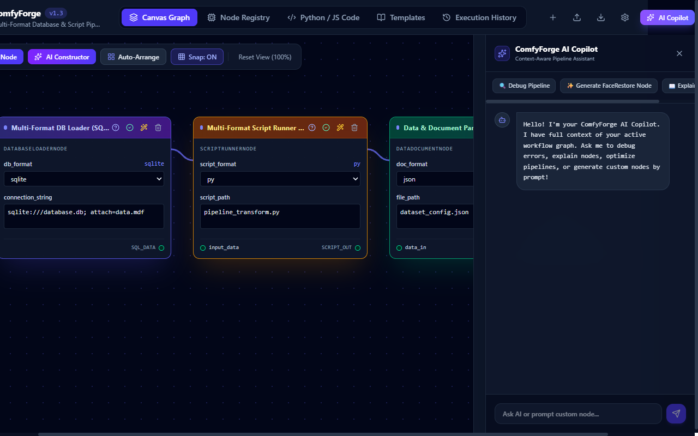
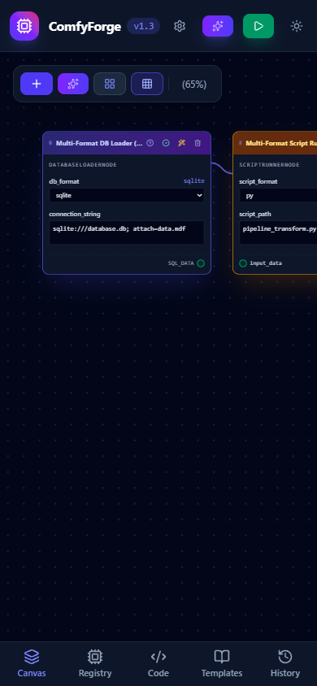
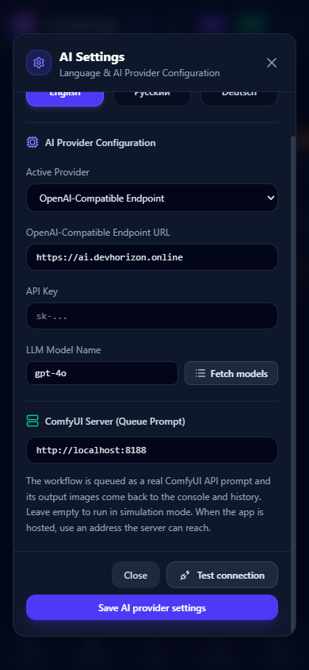
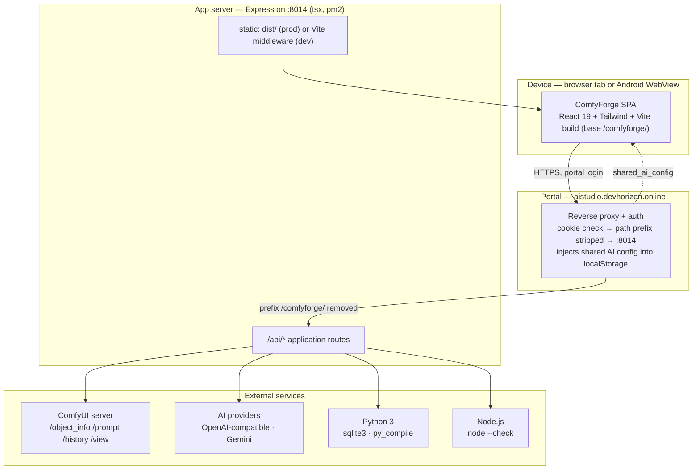

# ComfyForge AI IDE

**English** · [Русский](README.ru.md) · [Deutsch](README.de.md)

A ComfyUI-style visual node IDE that runs in the browser (and as an Android app):
a node graph you can build and wire by hand, real import/export of ComfyUI
workflow JSON, execution against a real ComfyUI server, a SQLite console, and an
AI copilot that sees the whole workflow.



| | |
|---|---|
| **Live app** | https://aistudio.devhorizon.online/comfyforge/ (behind portal login) |
| **Source** | https://github.com/sashok53011/comfyforge-ai-ide |
| **Android APK** | [Settings → Android APK](https://aistudio.devhorizon.online/comfyforge/) or `public/ComfyForge-AI-IDE.apk` in this repo |
| **Stack** | React 19 · Vite 8 · Tailwind 4 · Express · TypeScript · Capacitor 8 |

---

## Table of contents

1. [Features](#features)
2. [Screenshots](#screenshots)
3. [Architecture](#architecture)
4. [Directory structure](#directory-structure)
5. [Server API](#server-api)
6. [Frontend data flow](#frontend-data-flow)
7. [Execution flows](#execution-flows)
8. [State and persistence](#state-and-persistence)
9. [Portal integration](#portal-integration)
10. [Android app](#android-app)
11. [Security decisions](#security-decisions)
12. [Run, build, deploy](#run-build-deploy)
13. [Known limitations](#known-limitations)
14. [TODO](#todo)
15. [Commands](#commands)

---

## Features

**Graph editor**
- Add / drag / delete nodes, auto-arrange, snap-to-grid, zoom & pan.
- **Connections**: tap an output port, then an input port — type-checked, one
  link per input, `Esc` or a tap on empty canvas cancels.
- **Touch input**: pointer events + pinch-zoom, bottom tab bar on phones,
  full-screen inspector sheet, `touch-action: none` on the canvas.

**ComfyUI compatibility**
- Export the real ComfyUI *Save* format (drop the file on a ComfyUI canvas) and
  import *Save*, *API (prompt)* and ComfyForge's own exports (lossless — the
  internal snapshot travels in `extra.comfyforge`).
- **Execution**: the workflow is converted to the API prompt format, node
  classes are validated against the server's `/object_info`, submitted to
  `/prompt`, polled via `/history/{id}` and output images stream back through
  `/api/comfy/view`. Without a server URL the run is flagged `simulation`.

**Data & code**
- **SQLite console** — statements run on the server through Python's `sqlite3`
  (allowlisted, one statement, 200-row cap). The resulting database round-trips
  through the browser, so `CREATE → INSERT → SELECT` persist between runs, and
  an existing `.sqlite/.db` file can be attached.
- **Schema graph** — built from the workflow's data nodes plus the real tables
  and `FOREIGN KEY` edges of the attached database.
- **Code Studio** — real syntax checks (`python3 -m py_compile` /
  `node --check`), parse only, snippet persisted between reloads.
- **Execution history** — every run (success / failure / simulation) with
  duration, prompt id, outputs, error and a workflow snapshot; *Restore* puts
  the snapshot back on the canvas.

**AI**
- Copilot (`/api/copilot/chat`) with full workflow context: explain, review,
  and rewrite node parameters — the per-node buttons are real calls.
- Node constructor (`/api/copilot/generate-node`) returns a full node spec;
  the generated Python is shown in the Node Inspector (copy button) and
  exported with the workflow.
- Providers: **Gemini** (server key or key from Settings) or any
  **OpenAI-compatible endpoint** — with *Fetch models*, *Test connection* and
  validated *Save* in Settings.
- Interface: English / Русский / Deutsch, dark & light themes, both persisted.

---

## Screenshots

| Desktop | Android (390×844) | Android settings |
|---|---|---|
|  |  |  |

---

## Architecture

### High-level



### Layers

| Layer | Tech | Where | Responsibility |
|---|---|---|---|
| UI | React 19, Tailwind 4, lucide-react, d3 | `src/` | graph editor, panels, modals, i18n, themes |
| Build | Vite 8 (`--base=/comfyforge/`) | `vite.config.ts` | bundle + path prefix for the portal |
| API | Express 4 (TypeScript, run by `tsx`) | `server.ts` | AI, ComfyUI proxy, SQL, code checks, static |
| Converters | pure TS | `src/lib/comfyFormat.ts` | internal ⇄ ComfyUI Save ⇄ API prompt |
| Platform | Capacitor 8 | `capacitor.config.ts`, `android/` | WebView wrapper loading the live site |
| Gateway | portal (separate app) | `aistudio-portal` | auth, path prefix, shared AI config |

### Directory structure

```
comfyforge-ai-ide/
├─ server.ts                  # Express app: AI, ComfyUI, SQL, code endpoints + static hosting
├─ index.html                 # entry, mobile viewport + theme-color
├─ vite.config.ts             # React + Tailwind, alias @/, base /comfyforge/
├─ capacitor.config.ts        # Android WebView → https://aistudio.devhorizon.online/comfyforge/
├─ metadata.json              # AI Studio manifest
├─ public/
│  └─ ComfyForge-AI-IDE.apk   # built APK, served by the site (Settings → Android APK)
├─ src/
│  ├─ App.tsx                 # root state: workflow, AI config, ComfyUI URL, runs, DB, theme/lang
│  ├─ api.ts                  # apiUrl() prefix helper + askCopilot() + stripCodeFences()
│  ├─ i18n.ts                 # EN/RU/DE dictionary, LanguageContext, useT()
│  ├─ types.ts                # Workflow / ComfyNodeData / AIProviderConfig / DbTable
│  ├─ index.css               # Tailwind + light-theme overrides + mobile/touch rules
│  ├─ components/             # Canvas, Navbar, AICopilot, ConsolePanel, NodeInspector,
│  │                          # CodeStudio, HistoryView, SettingsModal, SQLEditorModal,
│  │                          # SchemaVisualizer, MiniPreview, NodeLibraryModal,
│  │                          # TemplatesModal, AINodeConstructorModal
│  ├─ lib/
│  │  ├─ comfyFormat.ts       # converters + format detection (32 self-checks)
│  │  ├─ aiSettings.ts        # fetchModelList / testAiConnection / validate / save + cache
│  │  └─ runHistory.ts        # run journal in localStorage (max 30)
│  └─ data/templates.ts       # built-in workflows (SDXL, multi-format pipeline)
├─ scripts/
│  ├─ verify-comfy-format.ts  # 32 assertions over the converters
│  ├─ mock-openai-endpoint.mjs# local /models + /chat/completions double for tests
│  └─ make-android-icon.ps1   # launcher icon generator (GDI+)
├─ android/                   # Capacitor Android project (gradlew assembleDebug)
└─ docs/screenshots/          # images used by this README
```

---

## Server API

All routes live behind the portal's cookie auth when accessed through
`/comfyforge/`; the app server itself has no auth (it is only reachable via the
proxy or localhost).

| Method | Path | Purpose | Notes |
|---|---|---|---|
| POST | `/api/copilot/chat` | Copilot answer for the whole workflow | Gemini or OpenAI-compatible; history supported |
| POST | `/api/copilot/generate-node` | Node spec (ports, widgets, Python) | strict JSON output |
| POST | `/api/workflow/execute` | **Queue Prompt** — run a workflow | validates classes, submits, polls history, returns image URLs; `simulation: true` when no ComfyUI URL |
| GET | `/api/comfy/view` | Streams an image back from ComfyUI | keeps the ComfyUI address server-side |
| POST | `/api/code/validate` | Real syntax check | `py_compile` / `node --check`, temp dir, never executes |
| POST | `/api/sql/query` | Run one SQL statement | allowlist, 15 s timeout, returns rows **and** the resulting DB (base64) |
| POST | `/api/sql/schema` | Tables + columns of a DB | powers the schema graph |
| POST | `/api/ai/models` | Model catalogue for the dropdown | server-side proxy (no CORS), 10 s timeout |
| POST | `/api/ai/test` | One tiny completion, latency measured | proves key + endpoint + model |
| GET | `/*` | SPA fallback → `dist/index.html` (prod) or Vite (dev) | |

---

## Frontend data flow

`App.tsx` owns the state and passes it down; components never fetch on their own
except through the helpers in `src/api.ts` and `src/lib/`:

| State | Setter | Persisted in |
|---|---|---|
| `currentWorkflow` (nodes + links) | canvas edits, import, templates, history *Restore* | memory (export/import for backup) |
| `aiConfig` (provider, endpoint, key, model) | Settings → `saveAiSettings()` | `comfyforge.settings.ai` |
| `comfyuiUrl` | Settings | `comfyforge.comfyui.url` |
| `runs[]` | every `Queue Prompt` (success/failure/simulation) | `comfyforge.run_history` (max 30) |
| `dbState` (attached SQLite, base64) | SQL editor after each statement/attach | memory (browser round-trip) |
| `dbTables[]` | schema refresh after DB changes | memory (drives the ERD) |
| `language`, `isDarkMode` | Navbar / Settings | `comfyforge.language`, `comfyforge.theme` |

Portal-provided values: `comfyforge.ai-provider` (shared AI config injected by
the portal) and `comfyforge.models` (model-list cache per endpoint).

Key modules:

- **`lib/comfyFormat.ts`** — `exportToComfyUi` (Save format),
  `exportToComfyApiPrompt` (API prompt), `importFromComfy` (detects all three
  formats), plus widget-name/schema heuristics for foreign files.
- **`lib/aiSettings.ts`** — `fetchModelList`, `testAiConnection`,
  `validateAiConfig` (returns i18n keys), `saveAiSettings` (normalise + store),
  model cache.
- **`lib/runHistory.ts`** — journal entries with snapshot; `Restore` reloads it.
- **`i18n.ts`** — `LanguageContext` + `useT()`; ~200 keys in EN/RU/DE.

---

## Execution flows

**Queue Prompt**
1. `App` posts `{workflow, comfyui: {baseUrl}}` to `/api/workflow/execute`.
2. Server converts the workflow to the API prompt (`exportToComfyApiPrompt`).
3. No URL → `simulation: true` (shown with a badge, never faked as a run).
4. With a URL: `GET /object_info` (cached 10 min) → unknown class types fail
   immediately with the full list; then `POST /prompt`.
5. Poll `GET /history/{id}` every 500 ms (90 s cap — Cloudflare edge limit).
6. Errors surface as-is: ComfyUI `node_errors`, execution exceptions, timeouts.
7. Images are returned as `/api/comfy/view?...&baseUrl=...` and rendered in the
   console; the run (status, duration, prompt id, outputs, snapshot) goes to
   history.

**SQL statement**
1. Client sends `{query, sqliteBase64}` (database lives in the browser).
2. Server allowlists the statement (no `ATTACH`/`DETACH`/`VACUUM`), writes a
   scratch DB + query, runs a Python script under a 15 s timeout.
3. Response: columns/rows (≤200), duration, and the resulting DB as base64 so
   the next statement continues from here.

**AI call**
1. Settings validates → `saveAiSettings()` normalises and stores.
2. Copilot/node actions send `providerConfig` with the request (key travels
   per request, never stored server-side).
3. OpenAI-compatible: `chatCompletions()` tries `/models`-style paths with
   fallback; Gemini: SDK with the key from Settings or `GEMINI_API_KEY`.

---

## State and persistence

| Key | Owner | Content |
|---|---|---|
| `comfyforge.settings.ai` | app | AI provider config (endpoint, key, model) |
| `comfyforge.comfyui.url` | app | ComfyUI base URL (empty = simulation) |
| `comfyforge.ai-provider` | portal | shared AI config (`baseUrl`, `apiKey`, `model`) |
| `comfyforge.run_history` | app | run journal with workflow snapshots |
| `comfyforge.codestudio` | app | code snippet + language |
| `comfyforge.models` | app | model lists per provider/endpoint |
| `comfyforge.language` / `comfyforge.theme` | app | `en\|ru\|de`, `dark\|light` |

Nothing else is stored on the server: no user data, no keys, no databases.

---

## Portal integration

The portal (`aistudio-portal`, separate repository) is a gateway in front of
this app:

- **Path prefix**: the app is built with `--base=/comfyforge/` and the portal
  strips `^/comfyforge` before proxying to `localhost:8014` — root-absolute
  URLs therefore work (`apiUrl()` in `src/api.ts` wraps this rule).
- **Auth**: cookie checked by the portal; without a login you get the portal
  page, and API calls return 401.
- **Shared AI config**: the portal writes its AI Settings into
  `comfyforge.ai-provider`; the app prefers its own saved settings and tells
  you when they override the shared key.
- **Ownership**: apps are started by **pm2**, so the portal's `apps.json`
  entry must **not** contain `dir` (that would enable a second manager).
  Entry used here:

  ```json
  {
    "slug": "comfyforge",
    "name": "ComfyForge AI IDE",
    "port": 8014,
    "icon": "🛠️",
    "localStorageKeys": { "comfyforge.ai-provider": "full" }
  }
  ```

---

## Android app

A Capacitor wrapper that opens the **live site**, so login, localStorage and
every API call behave exactly as in a browser (updates arrive automatically —
no APK release needed for web changes).

- `capacitor.config.ts` → `server.url = https://aistudio.devhorizon.online/comfyforge/`
- `minSdk 24` (Android 7.0+), `targetSdk 36`, only `INTERNET` permission,
  debug-signed, ~4.4 MB.
- Launcher icons generated by `scripts/make-android-icon.ps1` (dark tile,
  glowing node graph, adaptive icon).
- Build: `npm run build && bunx cap sync android && cd android && ./gradlew.bat assembleDebug`.

---

## Security decisions

- **SQL**: allowlist of statement kinds, single statement per request,
  `ATTACH`/`DETACH`/`VACUUM` blocked, scratch DB in a temp dir that is deleted
  afterwards, 15 s timeout, 200-row cap. SQLite runs without extension loading.
- **Code checks**: parse only (`py_compile`, `node --check`) — code is never
  executed; temp files are removed in `finally`.
- **Model list**: fetched by the server (`/api/ai/models`) — no CORS problems
  and the key travels server → provider instead of browser → provider.
- **Keys**: entered in Settings, sent per request, never written to the server,
  never committed (the repository contains only a mock key for local tests).
- **Portal**: cookie auth in front; without login the app and its API are not
  reachable from the internet. The raw app port is firewalled on the host
  (only 22/80/443 are open to the LAN).
- **Remote URL**: WebView allows navigation only for
  `aistudio.devhorizon.online` and `ai.devhorizon.online`, cleartext disabled.

---

## Run, build, deploy

### Run locally

```bash
npm install        # or: bun install
npm run dev        # http://localhost:3000
```

Set `GEMINI_API_KEY` in `.env` only for the Gemini provider. In
*Settings → ComfyUI Server* point at a running ComfyUI (default
`http://localhost:8188`) for real execution; leave it empty for simulation.

### Build & run in production mode

```bash
npm run build      # vite build --base=/comfyforge/  -> dist/
NODE_ENV=production PORT=8014 npm run dev
```

### Deploy to the portal host

1. Copy the project (never `node_modules`) to
   `/home/sashok5301/comfyforge-ai-ide/`.
2. `npm install`, create `.env` with `PORT=8014` and `NODE_ENV=production`.
3. Start under pm2:
   `pm2 start ./node_modules/.bin/tsx --name comfyforge --interpreter /usr/bin/node --cwd /home/sashok5301/comfyforge-ai-ide -- server.ts && pm2 save`
4. Register the app in the portal's `apps.json` (no `dir` field, see above).
5. `pm2 restart aistudio-portal` (picks up `apps.json`).

Static files need no restart; `server.ts` changes need
`pm2 restart comfyforge`. The ComfyUI URL in Settings must be reachable **from
the host** (the portal runs on the Pi — `localhost` there is the Pi itself).

---

## Known limitations

- The multi-format nodes (`DatabaseLoaderNode`, `ScriptRunnerNode`,
  `DDL/DQL/DML/DCL/TCL`, …) are this IDE's own building blocks: ComfyUI does
  not know them, so a run that includes them stops with
  *“Not available on … : DB Loader [DatabaseLoaderNode], …”*. Keep them for
  modelling/SQL work; use real ComfyUI node types for execution.
- Execution needs models installed in ComfyUI: a workflow asking for a missing
  checkpoint fails with ComfyUI's own validation error.
- The mini preview describes a port (type, direction); pixel data exists only
  after a real run (see console and history).
- Server-side messages (SQLite errors, ComfyUI errors, syntax checks) are
  English; the interface chrome is translated in EN/RU/DE.
- The app server has no auth of its own — it relies on the portal in front and
  on host firewall rules.

---

## TODO

Priorities: **P1** = core fidelity, **P2** = features, **P3** = polish.

### P1 — execution & ComfyUI fidelity

- [ ] **Stream execution progress** (SSE or WebSocket from the app server)
      instead of a blocking history poll — today the request is capped at 90 s
      because of the Cloudflare edge limit.
- [ ] **Queue management**: show the ComfyUI queue, cancel/interrupt a run
      (`GET /queue`, `POST /interrupt`), and allow starting the next workflow
      while one is running.
- [ ] **Real output gallery in history**: store `prompt_id` and fetch
      `/history/{id}` on demand — all images, not just the first, plus
      re-download and delete.
- [ ] **Node catalog from ComfyUI**: offer the nodes actually installed on the
      server (from `/object_info`) in the registry, with their real input/output
      types instead of the built-in set only.
- [ ] **Round-trip fixtures**: commit real ComfyUI-saved workflows and assert
      import → export → import stability (extend `verify-comfy-format.ts`).

### P2 — editor, data, AI

- [ ] **Undo / redo** (Ctrl+Z, Ctrl+Shift+Z), keyboard shortcuts (Delete,
      Duplicate, multi-select with Shift/⌘, marquee selection).
- [ ] **Connect `customCode` to Code Studio**: "Open in Code Studio" for the
      AI-generated node code, plus sandboxed *run* (timeout, no network) beyond
      the current syntax check.
- [ ] **SQL upgrades**: multi-statement scripts/transactions, CSV export,
      table browser, move the attached database to IndexedDB (localStorage is
      ~5 MB), `PRAGMA foreign_key_list` for real FK edges in the ERD.
- [ ] **Workflow lint panel**: dangling inputs, type mismatches and nodes
      unknown to the target ComfyUI *before* running (connection-time checks
      already exist).
- [ ] **Server-side run history** per portal user (currently localStorage →
      one device), with sync and export/import.
- [ ] **Copilot streaming** answers and a token/usage indicator; per-user
      server-side API keys so keys stop travelling with every request.
- [ ] **Mobile palette**: node library as a bottom sheet, long-press context
      menu on nodes, larger hit areas for ports on tablets.

### P3 — platform, quality, polish

- [ ] **PWA**: manifest + service worker → installable on Android without the
      APK, offline shell, "add to home screen" prompt.
- [ ] **Android release**: keystore, `assembleRelease` with R8, Play Store
      listing, splash screen, `comfyforge://` deep links (web updates already
      ship automatically through the live URL).
- [ ] **i18n**: translate server-generated messages client-side, add
      ES/FR/UK/ZH, plural rules, and a translation-coverage check in CI.
- [ ] **Accessibility**: full keyboard path through the canvas, ARIA roles for
      ports/links, focus rings, WCAG contrast pass for the light theme.
- [ ] **Testing & CI**: promote the scripts to vitest, Playwright E2E at
      desktop + phone viewports, GitHub Actions (lint → build → APK artifact on
      tag).
- [ ] **Observability**: structured server logs, `/api/health` with dependency
      checks (ComfyUI reachable, Python present, disk), client error reporting.
- [ ] **Portal admin UI** for apps (currently manual `apps.json` edits) and
      rate limiting on `/api/ai/*` + `/api/copilot/*`.
- [ ] Decide on a **LICENSE** and add a CONTRIBUTING note.

---

## Commands

| Command | What it does |
|---|---|
| `npm run dev` | dev server (Vite middleware) — or production server when `NODE_ENV=production` |
| `npm run build` | production bundle with `--base=/comfyforge/` |
| `npm run lint` | `tsc --noEmit` with `strict`, `noUnusedLocals`, `noUnusedParameters` |
| `npx tsx scripts/verify-comfy-format.ts` | 32 checks for the ComfyUI converters |
| `node scripts/mock-openai-endpoint.mjs [port]` | local OpenAI-compatible double (key `sk-test-123`) |
| `pwsh -File scripts/make-android-icon.ps1` | regenerate the launcher icon set |
| `bunx cap sync android && cd android && ./gradlew.bat assembleDebug` | build the APK |
