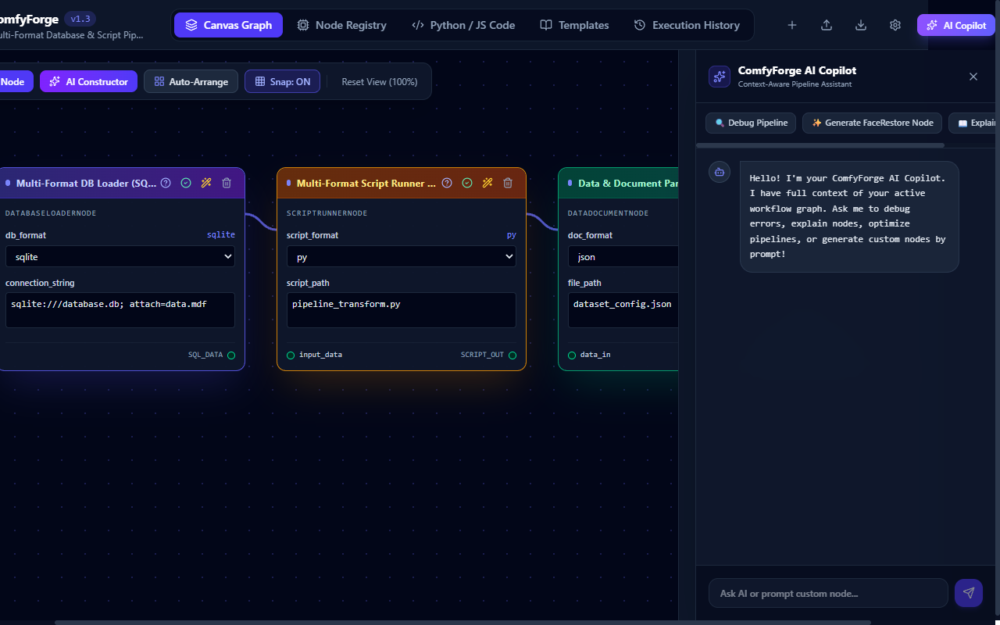
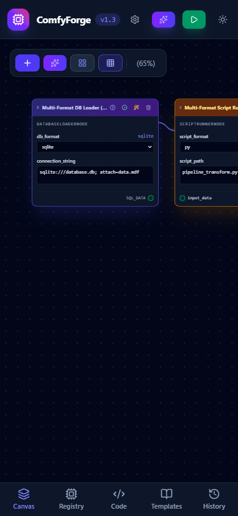
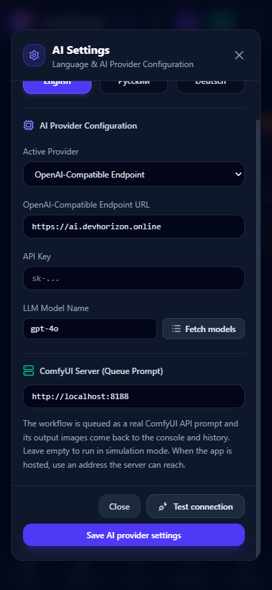
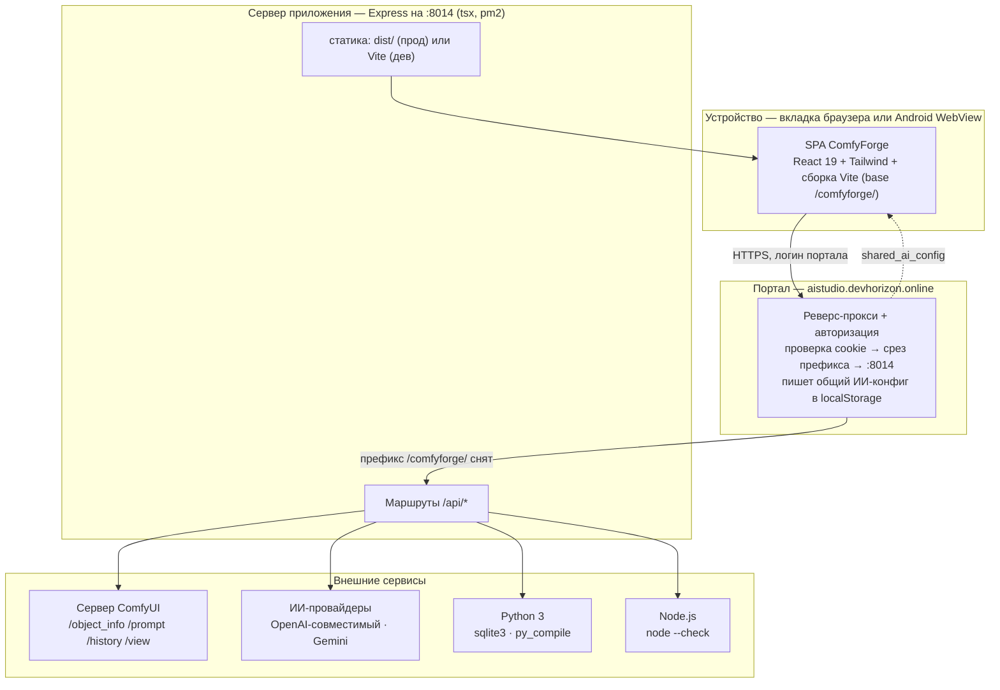

# ComfyForge AI IDE

[English](README.md) · **Русский** · [Deutsch](README.de.md)

Визуальный IDE с узлами в стиле ComfyUI, который работает в браузере (и как
Android-приложение): граф узлов, который можно собирать и соединять вручную,
честный импорт/экспорт JSON воркфлоу ComfyUI, запуск на реальном сервере
ComfyUI, SQL-консоль на SQLite и ИИ-копилот, который видит весь воркфлоу.



| | |
|---|---|
| **Приложение** | https://aistudio.devhorizon.online/comfyforge/ (за логином портала) |
| **Исходники** | https://github.com/sashok53011/comfyforge-ai-ide |
| **Android APK** | Настройки → Android APK на сайте или `public/ComfyForge-AI-IDE.apk` в репозитории |
| **Стек** | React 19 · Vite 8 · Tailwind 4 · Express · TypeScript · Capacitor 8 |

---

## Содержание

1. [Возможности](#возможности)
2. [Скриншоты](#скриншоты)
3. [Архитектура](#архитектура)
4. [Структура каталогов](#структура-каталогов)
5. [API сервера](#api-сервера)
6. [Потоки данных фронтенда](#потоки-данных-фронтенда)
7. [Сценарии выполнения](#сценарии-выполнения)
8. [Состояние и персистентность](#состояние-и-персистентность)
9. [Интеграция с порталом](#интеграция-с-порталом)
10. [Android-приложение](#android-приложение)
11. [Решения по безопасности](#решения-по-безопасности)
12. [Запуск, сборка, деплой](#запуск-сборка-деплой)
13. [Известные ограничения](#известные-ограничения)
14. [TODO](#todo)
15. [Команды](#команды)

---

## Возможности

**Редактор графа**
- Добавление / перетаскивание / удаление узлов, авто-раскладка, привязка к
  сетке, зум и панорамирование.
- **Соединения**: тап по выходному порту, затем по входному — проверка
  типов, один вход — одна связь, `Esc` или тап по пустому холсту отменяет.
- **Тач-ввод**: pointer-события + pinch-zoom, нижняя панель вкладок на
  телефонах, полноэкранный инспектор, `touch-action: none` на холсте.

**Совместимость с ComfyUI**
- Экспорт в реальный формат *Save* ComfyUI (файл можно бросить на канвас
  ComfyUI) и импорт *Save*, *API (prompt)* и собственных выгрузок (без потерь —
  внутренний снимок едет в `extra.comfyforge`).
- **Выполнение**: воркфлоу конвертируется в API-prompt, классы нод сверяются с
  `/object_info` сервера, отправляются в `/prompt`, опрашиваются через
  `/history/{id}`, а картинки возвращаются через `/api/comfy/view`. Без URL
  сервера запуск помечается как `simulation`.

**Данные и код**
- **SQL-консоль** — запросы выполняются на сервере через Python `sqlite3`
  (allowlist, один запрос, лимит 200 строк). Результат базы возвращается в
  браузер, поэтому `CREATE → INSERT → SELECT` живут между запросами; можно
  прикрепить существующий файл `.sqlite/.db`.
- **Схема БД** — строится из узлов данных воркфлоу и реальных таблиц с
  ребрами `FOREIGN KEY` подключённой базы.
- **Code Studio** — настоящая проверка синтаксиса (`python3 -m py_compile`,
  `node --check`), только разбор, сниппет сохраняется между перезагрузками.
- **История запусков** — каждый запуск (успех / ошибка / симуляция) с
  длительностью, prompt id, выходами, ошибкой и снимком воркфлоу;
  *Восстановить* возвращает снимок на холст.

**ИИ**
- Копилот (`/api/copilot/chat`) с полным контекстом воркфлоу: объяснение,
  ревью и переписывание параметров узла — кнопки на узлах делают реальные
  запросы.
- Конструктор нод (`/api/copilot/generate-node`) возвращает полную
  спецификацию; сгенерированный Python виден в инспекторе (кнопка «Копировать»)
  и выезжает вместе с воркфлоу.
- Провайдеры: **Gemini** (серверный ключ или ключ из настроек) или любой
  **OpenAI-совместимый эндпоинт** — с кнопками *Получить список моделей*,
  *Проверить подключение* и валидируемым *Сохранить* в настройках.
- Интерфейс: English / Русский / Deutsch, тёмная и светлая темы — обе
  сохраняются.

---

## Скриншоты

| Десктоп | Android (390×844) | Android, настройки |
|---|---|---|
|  |  |  |

---

## Архитектура

### Общая схема



### Слои

| Слой | Технологии | Где | Ответственность |
|---|---|---|---|
| UI | React 19, Tailwind 4, lucide-react, d3 | `src/` | редактор графа, панели, модалки, i18n, темы |
| Сборка | Vite 8 (`--base=/comfyforge/`) | `vite.config.ts` | бандл + префикс пути для портала |
| API | Express 4 (TypeScript, запуск через `tsx`) | `server.ts` | ИИ, прокси ComfyUI, SQL, проверки кода, статика |
| Конвертеры | чистый TypeScript | `src/lib/comfyFormat.ts` | внутренний ⇄ ComfyUI Save ⇄ API prompt |
| Платформа | Capacitor 8 | `capacitor.config.ts`, `android/` | WebView-обёртка над живым сайтом |
| Шлюз | портал (отдельное приложение) | `aistudio-portal` | авторизация, префикс пути, общий ИИ-конфиг |

### Структура каталогов

```
comfyforge-ai-ide/
├─ server.ts                  # Express: ИИ, ComfyUI, SQL, код + раздача статики
├─ index.html                 # точка входа, мобильный viewport + theme-color
├─ vite.config.ts             # React + Tailwind, алиас @/, base /comfyforge/
├─ capacitor.config.ts        # Android WebView → https://aistudio.devhorizon.online/comfyforge/
├─ metadata.json              # манифест AI Studio
├─ public/
│  └─ ComfyForge-AI-IDE.apk   # собранный APK, раздаётся сайтом (Настройки → Android APK)
├─ src/
│  ├─ App.tsx                 # корневое состояние: воркфлоу, ИИ-конфиг, URL ComfyUI, запуски, БД, тема/язык
│  ├─ api.ts                  # хелпер префикса apiUrl() + askCopilot() + stripCodeFences()
│  ├─ i18n.ts                 # словарь EN/RU/DE, LanguageContext, useT()
│  ├─ types.ts                # Workflow / ComfyNodeData / AIProviderConfig / DbTable
│  ├─ index.css               # Tailwind + оверрайды светлой темы + мобильные/touch-правила
│  ├─ components/             # Canvas, Navbar, AICopilot, ConsolePanel, NodeInspector,
│  │                          # CodeStudio, HistoryView, SettingsModal, SQLEditorModal,
│  │                          # SchemaVisualizer, MiniPreview, NodeLibraryModal,
│  │                          # TemplatesModal, AINodeConstructorModal
│  ├─ lib/
│  │  ├─ comfyFormat.ts       # конвертеры + определение формата (32 самопроверки)
│  │  ├─ aiSettings.ts        # fetchModelList / testAiConnection / validate / save + кеш
│  │  └─ runHistory.ts        # журнал запусков в localStorage (макс. 30)
│  └─ data/templates.ts       # встроенные воркфлоу (SDXL, мультиформатный пайплайн)
├─ scripts/
│  ├─ verify-comfy-format.ts  # 32 утверждения о конвертерах
│  ├─ mock-openai-endpoint.mjs# локальный двойник /models + /chat/completions для тестов
│  └─ make-android-icon.ps1   # генератор иконок (GDI+)
├─ android/                   # Android-проект Capacitor (gradlew assembleDebug)
└─ docs/screenshots/          # картинки для этого README
```

---

## API сервера

Все маршруты за cookie-авторизацией портала при обращении через
`/comfyforge/`; сам сервер приложений авторизации не имеет (доступен только
через прокси или с localhost).

| Метод | Путь | Назначение | Примечания |
|---|---|---|---|
| POST | `/api/copilot/chat` | ответ копилота по всему воркфлоу | Gemini или OpenAI-совместимый; поддерживается история |
| POST | `/api/copilot/generate-node` | спецификация ноды (порты, виджеты, Python) | строгий JSON |
| POST | `/api/workflow/execute` | **Queue Prompt** — запуск воркфлоу | валидация классов, отправка, опрос истории, URL картинок; `simulation: true` без URL ComfyUI |
| GET | `/api/comfy/view` | отдаёт картинку из ComfyUI | адрес ComfyUI остаётся на сервере |
| POST | `/api/code/validate` | реальная проверка синтаксиса | `py_compile` / `node --check`, временная папка, код не выполняется |
| POST | `/api/sql/query` | один SQL-запрос | allowlist, таймаут 15 с, возвращает строки **и** базу (base64) |
| POST | `/api/sql/schema` | таблицы и колонки базы | питает схему БД |
| POST | `/api/ai/models` | список моделей для выпадающего списка | серверный прокси (нет CORS), таймаут 10 с |
| POST | `/api/ai/test` | один микро-запрос с замером задержки | доказывает, что ключ/эндпоинт/модель рабочие |
| GET | `/*` | SPA-fallback → `dist/index.html` (прод) или Vite (дев) | |

---

## Потоки данных фронтенда

`App.tsx` владеет состоянием и раздаёт его вниз; компоненты сами по себе ничего
не запрашивают, кроме хелперов из `src/api.ts` и `src/lib/`:

| Состояние | Кто меняет | Где хранится |
|---|---|---|
| `currentWorkflow` (узлы + связи) | правки на канвасе, импорт, шаблоны, *Восстановить* из истории | память (бэкап через экспорт/импорт) |
| `aiConfig` (провайдер, эндпоинт, ключ, модель) | Настройки → `saveAiSettings()` | `comfyforge.settings.ai` |
| `comfyuiUrl` | Настройки | `comfyforge.comfyui.url` |
| `runs[]` | каждый Queue Prompt (успех/ошибка/симуляция) | `comfyforge.run_history` (макс. 30) |
| `dbState` (прикреплённая SQLite, base64) | SQL-редактор после каждого запроса/прикрепления | память (ходится через браузер) |
| `dbTables[]` | обновление схемы после изменений БД | память (питает ERD) |
| `language`, `isDarkMode` | Navbar / Настройки | `comfyforge.language`, `comfyforge.theme` |

Значения от портала: `comfyforge.ai-provider` (общий ИИ-конфиг, который пишет
портал) и `comfyforge.models` (кеш списков моделей по эндпоинту).

Ключевые модули:

- **`lib/comfyFormat.ts`** — `exportToComfyUi` (формат Save),
  `exportToComfyApiPrompt` (API prompt), `importFromComfy` (определяет все три
  формата) плюс эвристики имён виджетов и схем для чужих файлов.
- **`lib/aiSettings.ts`** — `fetchModelList`, `testAiConnection`,
  `validateAiConfig` (возвращает ключи i18n), `saveAiSettings` (нормализация +
  запись), кеш моделей.
- **`lib/runHistory.ts`** — записи со снимком; *Восстановить* загружает его.
- **`i18n.ts`** — `LanguageContext` + `useT()`; ~200 ключей в EN/RU/DE.

---

## Сценарии выполнения

**Queue Prompt**
1. `App` отправляет `{workflow, comfyui: {baseUrl}}` в `/api/workflow/execute`.
2. Сервер конвертирует воркфлоу в API-prompt (`exportToComfyApiPrompt`).
3. URL нет → `simulation: true` (показывается бейджем, никогда не выдаётся за
   реальный запуск).
4. URL есть: `GET /object_info` (кеш 10 мин) → неизвестные типы классов падают
   сразу со полным списком; затем `POST /prompt`.
5. Опрос `GET /history/{id}` каждые 500 мс (лимит 90 с — из-за края Cloudflare).
6. Ошибки доходят как есть: `node_errors` ComfyUI, исключения выполнения,
   таймауты.
7. Картинки возвращаются как `/api/comfy/view?...&baseUrl=...` и рисуются в
   консоли; запуск (статус, длительность, prompt id, выходы, снимок) уходит в
   историю.

**SQL-запрос**
1. Клиент шлёт `{query, sqliteBase64}` (база живёт в браузере).
2. Сервер проверяет запрос по allowlist (без `ATTACH`/`DETACH`/`VACUUM`),
   пишет временную базу + запрос, выполняет Python-скрипт с таймаутом 15 с.
3. Ответ: колонки/строки (≤200), длительность и база-результат в base64, чтобы
   следующий запрос продолжал отсюда.

**ИИ-вызов**
1. Настройки проходят валидацию → `saveAiSettings()` нормализует и сохраняет.
2. Копилот/действия над нодами шлют `providerConfig` с запросом (ключ едет с
   запросом, на сервере не хранится).
3. OpenAI-совместимый: `chatCompletions()` пробует пути с фолбэком; Gemini: SDK
   с ключом из настроек или `GEMINI_API_KEY`.

---

## Состояние и персистентность

| Ключ | Владелец | Содержимое |
|---|---|---|
| `comfyforge.settings.ai` | приложение | конфиг ИИ-провайдера (эндпоинт, ключ, модель) |
| `comfyforge.comfyui.url` | приложение | базовый URL ComfyUI (пусто = симуляция) |
| `comfyforge.ai-provider` | портал | общий ИИ-конфиг (`baseUrl`, `apiKey`, `model`) |
| `comfyforge.run_history` | приложение | журнал запусков со снимками воркфлоу |
| `comfyforge.codestudio` | приложение | сниппет кода и язык |
| `comfyforge.models` | приложение | списки моделей по провайдеру/эндпоинту |
| `comfyforge.language` / `comfyforge.theme` | приложение | `en\|ru\|de`, `dark\|light` |

Больше на сервере ничего не хранится: ни пользовательских данных, ни ключей, ни
баз.

---

## Интеграция с порталом

Портал (`aistudio-portal`, отдельный репозиторий) — шлюз перед этим приложением:

- **Префикс пути**: приложение собирается с `--base=/comfyforge/`, портал
  срезает `^/comfyforge` перед проксированием на `localhost:8014` — поэтому
  абсолютные URL работают (`apiUrl()` в `src/api.ts` инкапсулирует это правило).
- **Авторизация**: портал проверяет cookie; без логина вы получаете страницу
  портала, а API-вызовы возвращают 401.
- **Общий ИИ-конфиг**: портал пишет свои AI Settings в
  `comfyforge.ai-provider`; приложение предпочитает собственные сохранённые
  настройки и сообщает, когда они перекрывают общий ключ.
- **Владение**: приложения запускает **pm2**, поэтому запись в `apps.json`
  портала **не должна** содержать `dir` (иначе включится второй менеджер).
  Используемая запись:

  ```json
  {
    "slug": "comfyforge",
    "name": "ComfyForge AI IDE",
    "port": 8014,
    "icon": "🛠️",
    "localStorageKeys": { "comfyforge.ai-provider": "full" }
  }
  ```

---

## Android-приложение

Обёртка Capacitor, которая открывает **живой сайт**, поэтому логин,
localStorage и все API-вызовы ведут себя ровно как в браузере (обновления
приезжают автоматически — релиз APK для веб-изменений не нужен).

- `capacitor.config.ts` → `server.url = https://aistudio.devhorizon.online/comfyforge/`
- `minSdk 24` (Android 7.0+), `targetSdk 36`, только разрешение `INTERNET`,
  подпись debug, ~4.4 МБ.
- Иконки генерируются `scripts/make-android-icon.ps1` (тёмная плитка, светящийся
  граф узлов, адаптивная иконка).
- Сборка: `npm run build && bunx cap sync android && cd android && ./gradlew.bat assembleDebug`.

---

## Решения по безопасности

- **SQL**: allowlist типов операторов, один оператор на запрос,
  `ATTACH`/`DETACH`/`VACUUM` запрещены, временная база в tmp и удаляется
  после, таймаут 15 с, лимит 200 строк. SQLite без загрузки расширений.
- **Проверка кода**: только разбор (`py_compile`, `node --check`) — код никогда
  не выполняется; временные файлы удаляются в `finally`.
- **Список моделей**: запрашивает сервер (`/api/ai/models`) — нет проблем с
  CORS, и ключ идёт сервер → провайдер, а не браузер → провайдер.
- **Ключи**: вводятся в настройках, отправляются с запросом, на сервере не
  хранятся и в репозиторий не попадают (в репозитории только тестовый ключ из
  мока).
- **Портал**: впереди cookie-авторизация; без логина приложение и его API из
  интернета недоступны. Сырой порт приложения закрыт файрволом хоста (для LAN
  открыты только 22/80/443).
- **Удалённый URL**: WebView разрешает навигацию только для
  `aistudio.devhorizon.online` и `ai.devhorizon.online`, cleartext запрещён.

---

## Запуск, сборка, деплой

### Локальный запуск

```bash
npm install        # или: bun install
npm run dev        # http://localhost:3000
```

`GEMINI_API_KEY` в `.env` нужен только для провайдера Gemini. В
*Настройки → Сервер ComfyUI* укажите запущенный ComfyUI (по умолчанию
`http://localhost:8188`) для реального запуска; пусто = симуляция.

### Прод-режим

```bash
npm run build      # vite build --base=/comfyforge/  -> dist/
NODE_ENV=production PORT=8014 npm run dev
```

### Деплой на хост портала

1. Скопируйте проект (никогда `node_modules`) в
   `/home/sashok5301/comfyforge-ai-ide/`.
2. `npm install`, создайте `.env` с `PORT=8014` и `NODE_ENV=production`.
3. Запуск под pm2:
   `pm2 start ./node_modules/.bin/tsx --name comfyforge --interpreter /usr/bin/node --cwd /home/sashok5301/comfyforge-ai-ide -- server.ts && pm2 save`
4. Добавьте приложение в `apps.json` портала (без поля `dir`, см. выше).
5. `pm2 restart aistudio-portal` (подхватит `apps.json`).

Статика рестарта не требует; изменения в `server.ts` —
`pm2 restart comfyforge`. URL ComfyUI в настройках должен быть доступен **с
хоста** (портал работает на Pi — его `localhost` это сам Pi).

---

## Известные ограничения

- Мультиформатные ноды (`DatabaseLoaderNode`, `ScriptRunnerNode`,
  `DDL/DQL/DML/DCL/TCL`, …) — собственные строительные блоки IDE: ComfyUI их
  не знает, поэтому запуск с ними останавливается на
  *«Not available on … : DB Loader [DatabaseLoaderNode], …»*. Оставляйте их для
  моделирования/SQL, а для выполнения используйте реальные типы нод ComfyUI.
- Для выполнения нужны установленные в ComfyUI модели: воркфлоу с отсутствующим
  чекпоинтом упадёт с собственной ошибкой валидации ComfyUI.
- Мини-превью описывает порт (тип, направление); пиксели появляются только
  после реального запуска (см. консоль и историю).
- Сообщения сервера (ошибки SQLite, ComfyUI, проверки синтаксиса) — на
  английском; интерфейс переведён на EN/RU/DE.
- У сервера приложений своей авторизации нет — он опирается на портал перед ним
  и на правила файрвола хоста.

---

## TODO

Приоритеты: **P1** — точность исполнения, **P2** — функции, **P3** — полировка.

### P1 — исполнение и точность ComfyUI

- [ ] **Потоковый прогресс выполнения** (SSE или WebSocket с сервера) вместо
      блокирующего опроса истории — сейчас запрос ограничен 90 с из-за края
      Cloudflare.
- [ ] **Управление очередью**: показывать очередь ComfyUI, отменять/прерывать
      запуск (`GET /queue`, `POST /interrupt`) и запускать следующий воркфлоу,
      пока идёт предыдущий.
- [ ] **Реальная галерея выходов в истории**: хранить `prompt_id` и подтягивать
      `/history/{id}` по требованию — все картинки, плюс повторное скачивание и
      удаление.
- [ ] **Каталог нод из ComfyUI**: предлагать в реестре реально установленные
      на сервере ноды (из `/object_info`) с их настоящими типами входов/выходов,
      а не только встроенный набор.
- [ ] **Фикстуры round-trip**: закоммитить реальные файлы воркфлоу, сохранённые
      ComfyUI, и проверять стабильность импорт → экспорт → импорт (расширить
      `verify-comfy-format.ts`).

### P2 — редактор, данные, ИИ

- [ ] **Отмена/повтор** (Ctrl+Z, Ctrl+Shift+Z), горячие клавиши (Delete,
      Duplicate, множественный выбор через Shift/⌘, рамка выделения).
- [ ] **Связать `customCode` с Code Studio**: «Открыть в Code Studio» для
      сгенерированного ИИ кода ноды + изолированный *запуск* (таймаут, без
      сети) поверх текущей проверки синтаксиса.
- [ ] **Улучшения SQL**: многозапросные скрипты/транзакции, экспорт CSV,
      браузер таблиц, перенос прикреплённой базы в IndexedDB (в localStorage
      ~5 МБ), `PRAGMA foreign_key_list` для настоящих FK-рёбер в ERD.
- [ ] **Панель линта воркфлоу**: висящие входы, несовпадение типов и ноды,
      неизвестные целевому ComfyUI, *до* запуска (проверки при соединении уже
      есть).
- [ ] **Серверная история запусков** на пользователя портала (сейчас
      localStorage → одно устройство), с синхронизацией и экспортом/импортом.
- [ ] **Стриминг ответов копилота** и индикатор токенов/использования;
      серверные API-ключи на пользователя, чтобы ключи не ездили с каждым
      запросом.
- [ ] **Мобильная палитра**: библиотека нод как bottom sheet, контекстное меню
      по долгому тапу, большие зоны нажатия портов на планшетах.

### P3 — платформа, качество, полировка

- [ ] **PWA**: manifest + service worker → установка на Android без APK,
      офлайн-оболочка, промпт «добавить на главный экран».
- [ ] **Android-релиз**: keystore, `assembleRelease` с R8, листинг в Play,
      splash-экран, deep links `comfyforge://` (веб-обновления и так приезжают
      автоматически через живой URL).
- [ ] **i18n**: переводить сообщения сервера на клиенте, добавить ES/FR/UK/ZH,
      правила множественного числа и проверку покрытия переводов в CI.
- [ ] **Доступность**: полная клавиатурная навигация по канвасу, ARIA-роли для
      портов/связей, фокус-кольца, проверка контраста светлой темы на WCAG.
- [ ] **Тесты и CI**: перевести скрипты на vitest, Playwright E2E на десктопном
      и телефонном вьюпорте, GitHub Actions (lint → build → артефакт APK по
      тегу).
- [ ] **Наблюдаемость**: структурированные логи сервера, `/api/health` с
      проверками зависимостей (ComfyUI доступен, Python есть, диск), отчёт об
      ошибках клиента.
- [ ] **Админ-UI портала** для приложений (сейчас правки `apps.json` вручную) и
      rate limiting на `/api/ai/*` и `/api/copilot/*`.
- [ ] Решить вопрос с **LICENSE** и добавить CONTRIBUTING.

---

## Команды

| Команда | Что делает |
|---|---|
| `npm run dev` | дев-сервер (middleware Vite) — или прод-сервер при `NODE_ENV=production` |
| `npm run build` | прод-бандл с `--base=/comfyforge/` |
| `npm run lint` | `tsc --noEmit` с `strict`, `noUnusedLocals`, `noUnusedParameters` |
| `npx tsx scripts/verify-comfy-format.ts` | 32 проверки конвертеров ComfyUI |
| `node scripts/mock-openai-endpoint.mjs [порт]` | локальный двойник OpenAI-совместимого эндпоинта (ключ `sk-test-123`) |
| `pwsh -File scripts/make-android-icon.ps1` | перегенерировать набор иконок |
| `bunx cap sync android && cd android && ./gradlew.bat assembleDebug` | собрать APK |
